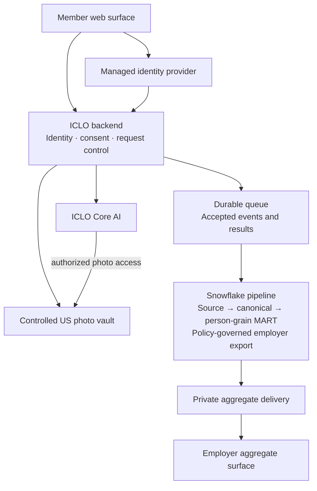
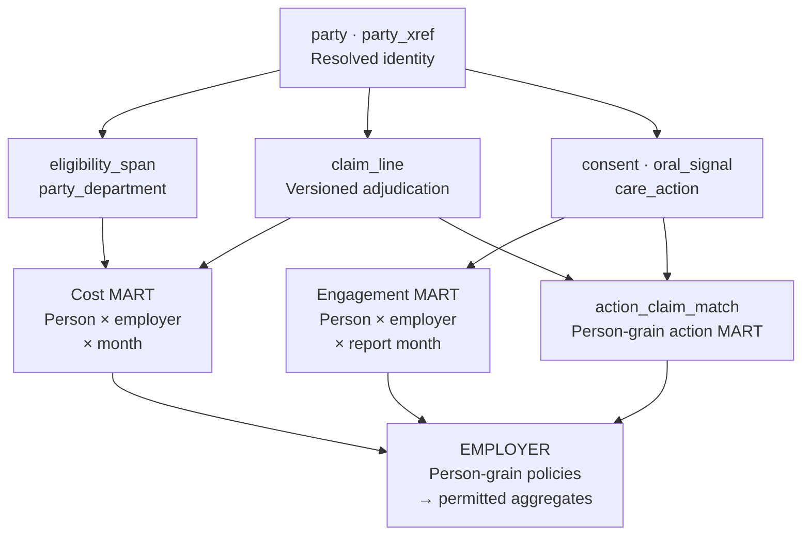

# ICLO × Snowflake — Software and data architecture

Technical annex · v14 · 7 September 2026  
Companion to the [collaboration proposal](proposal-EN.md) · English edition

This annex describes the target design for connecting member participation, photo-derived wellness signals and claims-confirmed care actions. Its purpose is to make responsibilities, interfaces and acceptance evidence concrete for ICLO and Snowflake architects. It is a design document, not an implementation approval or a statement that the system is operating.

The current repository runs a local synthetic web demo. Authentication, an application backend, controlled photo storage, the Core AI call path and an executed Snowflake pipeline are absent. The first 90 days concern relationships, architecture alignment and routes to resolve prerequisites. A3 is a separately authorized synthetic engineering stage; A2 adds real data and member services after its start gates close.

## 1. Three execution boundaries

| Stage | Input and software boundary | What its evidence can establish |
|---|---|---|
| Current demo | Contract YAML and HTML templates → pinned Python builder → local HTML/CSS/JavaScript and allowlisted JSON | Screen behavior, synthetic disclosure, bands, consent-state examples and local suppression |
| A3 target | Synthetic source files → Snowflake transformations and policies → validated tenant exports → aggregate screen | Reproducible transformations, distinct-person suppression, employer isolation and complete release handling |
| A2 target | Authorized source feeds and authenticated member requests → ICLO backend and private services → governed analytics and private delivery | Operation within approved legal, identity, consent, security and service boundaries |

The current builder is `scripts/build_screens.py`, using Python 3.14 and PyYAML. It reads `screens/*.html.in` and the contract, stages the employer and member screens, and permits alternate canon/output paths for perturbation tests. No frontend framework is added. For the employer screen, `canon.json` owns static presentation fields and demo values; the member screen uses `member-canon.json` and `member.json`. In A3/A2, measured employer values and freshness move to the export; the static contract remains built from YAML. The export's `synthetic` field controls the exact disclosure, “Synthetic data — illustrative only.”

Public GitHub Pages currently publishes one redirect. It is not the demo server or an authorized export destination. A3 delivery needs its own publication decision; A2 requires authenticated private delivery and cannot reuse public Pages for real records. Existing member consent checks run in the browser and demonstrate interaction, not server enforcement.

## 2. Detailed software architecture

The diagram shows target components. The browser surfaces have demo implementations; the operational components below them do not yet exist in this repository. Arrows represent authorized interfaces, not unrestricted data access.



| Component | Responsibility and access limit |
|---|---|
| Member web surface | Show the authenticated person's own band and direction; request consent, capture and support actions. Never carry Snowflake or inference service credentials |
| Identity provider | Managed passwordless OTP; canonical records hold contact references/hashes rather than contact text. Vendor selection remains open |
| Backend | Resolve credential, subject, employer eligibility context and purpose-specific authorization on every operation; bind requests to server-owned identity records |
| Photo vault | ICLO-controlled US storage, separate from the analytics account; encrypted originals and access evidence. A stored reference alone cannot retrieve a photo |
| Core AI | ICLO-operated inference behind service authentication. Return versioned quality status and a band; retain a request-to-inference trace |
| Queue and ingestion | Persist accepted events/results independently of browser lifetime; support replay and deduplication before canonical promotion |
| Employer delivery | Publish/query only authorized aggregates. Employer access never exposes a member profile, photo, numeric oral-health score or claim line |

The backend technology and storage vendor are not selected here. The design requires an authorization and durable-processing boundary, not a new service for every row in this table. An employer administrator who is also a member needs separate role/session contexts; switching contexts must not carry employer privileges into personal access or expose member activity to the employer.

### Request sequence and inference contract

1. The member authenticates through the managed IdP. The backend matches the first-phase, self-only profile to eligibility; OTP proves control of a contact channel, not the truth of an arbitrary identity claim.
2. The backend resolves the acting credential, `party_sk`, employer and eligibility episode. It evaluates required processing/photo consent, current policy version, expiry, withdrawal and active access immediately before the operation.
3. Authorized capture enters controlled storage. The backend binds an opaque image reference and consent record to a request; it rejects references supplied for another subject or employer.
4. The backend calls ICLO Core AI using the existing interface below. Image access is limited to the authorized service operation. The database reference itself is not an access token.
5. The backend validates the response, records its model version and inference identifier, and durably accepts the result for ingestion. The member sees only their own permitted band/direction; a failed quality gate is not a usable wellness signal.
6. The analytics pipeline applies consent/context rules, idempotency and metric deduplication. Only governed aggregates can reach the employer delivery path.

```text
POST /v1/oral-signal
Authorization: <service credential>

Request fields:
  image_ref       controlled image reference, not image bytes
  consent_ref     reference to the authorized consent record
  captured_at     capture timestamp
  request_id      stable identifier for this logical request

Successful response fields:
  model_version   required reproducibility identifier
  quality_passed  boolean
  signal_band     LOW | MODERATE | PRIORITY
  inference_id   traceable inference identifier
```

The existing storage column is `oral_signal.image_uri`; the API field is `image_ref`. The backend owns that mapping. The four-field API request does not carry a trusted subject or employer: the service must resolve those through the authenticated, server-created reference context. A bare `consent_ref` string is not proof of active authorization.

`request_id` must govern backend request acceptance and canonical deduplication. Repeated delivery of the same accepted request must not create another signal. Reusing it with changed subject, image or consent context must be rejected. Retries after a timeout need a recoverable result/status; a unique-key declaration or browser memory alone is insufficient. This is required behavior to implement and verify, not a claim of current exactly-once processing.

The recorded access design is backend-issued, five-minute, single-use photo access. Expiry alone does not provide single use: the consuming backend/gateway must atomically record consumption, reject replay, and define recovery after a failed inference. Storage-provider signed URLs alone must not be presented as enforcing this requirement. Authorization expiry or consent withdrawal must stop new processing; concurrent consumption and revocation need explicit tests.

Booking handoff, a member's booking self-report and a system-confirmed appointment remain separate events. Only the first two have demo examples. Neither establishes that a visit occurred. A future benefits gateway is also separate from analytics: historical claims cannot supply a reliable current remaining benefit maximum. That field remains unavailable until an authoritative accumulator source is contracted and integrated.

## 3. Detailed data architecture

### Source contracts and layer ownership

| Source | Intended input | Required agreement |
|---|---|---|
| Employer or benefits administrator | X12 834 eligibility, normally a monthly file | Stable member identifier, coverage dates, correction semantics, source instance and permitted purpose |
| HRIS or benefits administrator | Separate department master with effective dates | Organizational scope, employee linkage and department-change history |
| TPA/ASO | X12 837D/835 or agreed claims extracts | Adjudication versions, adjustment basis, amounts, service/receipt dates and delivery completeness |
| ICLO application | Consent, questionnaire, participation and care-action events | Actor, subject, employer context, event time, idempotency and authorization evidence |
| ICLO Core AI | Quality status and versioned photo-derived signal | Model version, image reference, request trace and capture time |

834 is an eligibility feed, not a department feed. Whether its PER segments contain usable contact information is a sample-file question, not an assumption. The first member phase is employee self-access; family access remains a later phase even though covered dependents contribute to eligible cost denominators.

SFTP/agreed batch extracts are a viable initial transport. If the TPA already uses compatible Snowflake infrastructure, Secure Data Sharing is an option to assess with the provider. Sharing is an access mechanism; it does not itself establish data rights, matching keys or a cross-region design. Neither a Native App nor a clean room is required for the initial scope. [Snowflake sharing documentation](https://docs.snowflake.com/en/user-guide/data-sharing-intro)

| Layer | Responsibility | Promotion condition |
|---|---|---|
| RAW | Preserve source payload and load identity for controlled replay | Receipt manifest, source identity and allowed input verified |
| STAGED | Parse types and standardize codes without losing source keys | Malformed records isolated; no silent coercion |
| CANONICAL | Resolve people and preserve eligibility, claims, consent and event histories | Identity exceptions, duplicate versions and invalid periods handled explicitly |
| Person-grain MART | Select versions, align grains and compute metric populations while retaining `party_sk` | Same-snapshot lineage, metric fixtures and privacy population verified |
| EMPLOYER | Restricted views over policy-protected person-grain objects | Actual employer-role queries pass isolation and minimum-cell tests |
| Export | Publish a coherent aggregate release with catalog and provenance | Entire release passes schema, time, ownership and suppression checks |

### Entities, grains and relationships



The arrows show logical dependencies, not permission to bypass the person-grain policy boundary. Care-action metrics also need a defined distinct-person population before employer aggregation.

| Object | Grain/key and invariant |
|---|---|
| `party` | One global person, keyed by `party_sk`; employer membership belongs to eligibility, not the person |
| `party_xref` | Unique source identity: source system + source instance + source ID. Different employers can reuse the same local ID |
| `eligibility_span` | Version of an eligibility episode. Select latest eligible snapshot within employer + stable episode ID |
| `member_month` | Eligibility span × month; keep covered days. Fold spans to person × employer × month before joining claims |
| `claim_line` | Adjudicated line version with employer/source context, service date and snapshot. Preserve reversal/adjustment lineage |
| `party_department` | Person × employer × effective interval. Unknown assignment uses `UNMATCHED`, never suppression `null` |
| `credential` / `profile_access` | Login identity and access grants are separate from person and device. Shared contact details do not imply one person |
| `consent` | Purpose/version/actor/subject/context and lifecycle evidence, including use, recipient and expiry |
| `oral_signal` | Versioned capture with person, employer, actor, quality, request and inference identifiers |
| `care_action` / `action_claim_match` | Action with target/window; explicit links to qualifying claim lines, confidence and closure reason |

Deterministic common identifiers take priority. Ambiguous or unmatched people enter an exception queue; the first phase does not use probabilistic matching to increase a headline match rate. Logical uniqueness must be verified during ingestion rather than inferred from declared keys.

### Temporal and financial rules

Source-effective time, event time, receipt/load time and report snapshot answer different questions. Preserve each. Select both eligibility and claims at the same `report_snapshot_seq`; never combine historical claims with today's revised denominator. A current-only `member_month` table cannot reproduce an earlier report unless the selected historical eligibility versions are re-expanded for that snapshot.

Normalize the sender's coverage-end convention explicitly. The current design uses an inclusive final covered date and actual calendar days per month. Coverage spans and claims must each be folded to person × employer × month before joining; otherwise plan changes duplicate claims or multiple claims duplicate coverage. Overlapping department assignments stop promotion rather than silently multiplying a person's measures.

Report-month rolling metrics use exactly `[M-11, M+1)`: from the start of the month eleven months before report month M, inclusive, to the start of the following month, exclusive. For September 2026, that is 1 October 2025 through 30 September 2026. Every latest-signal selection partitions by person, employer and report month, after filtering invalid captures.

Claims consumers share `claims_as_of` interpretation of paid, denied, reversed and adjusted versions. An original allowed amount of 100 followed by a replacement of 80 must yield 80, not 180. A delta of −20 requires a different interpretation. The current SQL design covers replacement semantics; delta handling remains a condition to implement or quarantine explicitly. PMPM, completeness and action matching cannot each invent their own adjustment logic.

Keep allowed, plan-paid and member out-of-pocket amounts distinct, with within-allowed responsibility, noncovered amounts and other-payer components available for reconciliation. A negative adjustment in the source is not the same as a malformed negative exported measure. Reconcile amounts using the TPA's documented mapping before promotion. Dental PMPM is allowed amount divided by covered member-months, not employee headcount.

## 4. Metric contract and employer controls

| Metric | Definition and reporting limit |
|---|---|
| Eligible employees | Distinct eligible employees in the report-month population |
| Activated | Those eligible employees who completed registration and first questionnaire by month end; numerator is cumulative within the current eligible population |
| People with a valid capture | Activated eligible employees with at least one valid capture in the report month. These three stages alone form the nested people funnel |
| Repeat participation | People with at least two valid captures / people with at least one in the same rolling 12 months |
| Signal distribution | One latest valid capture per person within employer context and rolling window; distinguish model versions or disclose the mixture |
| Open care actions | Unclosed actions still within their action window at reporting time; an action count, not another people-funnel stage |
| Completed actions | High-confidence, claims-confirmed actions within a mature cohort. A separate action count, not the completion percentage |

Valid captures share quality acceptance, one counted capture per person/date and a maximum of four per person/month. Mature actions satisfy `opened_at + window_days + claims-lag P90 < report time`. A completion rate, when supplied, divides qualifying completed actions by that mature action cohort. Recent cohorts are shown separately; P90 is not yet measured, so completion remains provisional. Open and completed actions have no nesting relationship: zero open actions can coexist with completed actions.

Row access controls employer membership; aggregation controls the size of the disclosed population. Apply aggregation policy with `ENTITY KEY (party_sk)` to person-grain MART objects after internal version selection and joins, not to already aggregated employer totals. Snowflake documents entity-aware aggregation and remainder behavior; this design still requires execution in the actual account. [Entity-level privacy](https://docs.snowflake.com/en/user-guide/aggregation-policies-entity-privacy), [row access policies](https://docs.snowflake.com/en/user-guide/security-row-intro)

Employer roles receive restricted EMPLOYER views and perform allowed aggregations. Internal engineering/analysis exemptions must be explicit in policy bodies and tested; a role name does not create an exemption. Prefer removing identifiers from employer projections; if masking is used, prove that it preserves the required entity-count semantics. D3 owns this decision. Snowflake documents aggregation policies as an Enterprise-or-higher feature. [Aggregation policies](https://docs.snowflake.com/en/user-guide/aggregation-policies)

Small groups may be combined by Snowflake into a remainder whose group keys are `NULL`; the database may still return aggregate values for that remainder. ICLO's export contract deliberately goes further: `department=null` has every measure set to `null`. The screen shows explicit suppression and no recoverable counts, percentages or bar lengths for that row. Department names remain in the separate catalog. Missing assignment (`UNMATCHED`), suppressed remainder and missing data are distinct states.

Minimum cell size is 20 distinct people. It does not eliminate inference from repeated related queries. The existing design also calls for fixed dimensions, adjacent suppression on both endpoints of risky comparisons, history-based refusal and query-combination limits. These are target controls, not implemented privacy guarantees. D5 must resolve rolling populations, department moves, dependent attribution and which measures may be summed. Small-cell denominator exposure is a separate design exception to assess; it must not expand the catalog beyond its approved schema.

## 5. Atomic export and failure handling

The current A3 contract names `employer-a.json`, `employer-b.json`, `employer-c.json` and `departments.json`. One release must have all four. The employer payload contains:

| Section | Required fields |
|---|---|
| Envelope | `schema_version`, `run_id`, `report_snapshot_seq`, `exported_at`, `employer_id`, `synthetic` |
| Freshness | `eligibility_thru`, `claims_thru`, `lag_days`, `completeness_pct` |
| Row identity | `month_start`, `department`, `employer_id` |
| Population and cost | `eligible_employees`, `covered_members`, `member_months`, `dental_pmpm` |
| Participation and signals | `activated`, `repeat_participation`, `signal_low`, `signal_moderate`, `signal_priority` |
| Actions | `open_actions`, `completed_actions`, `completed_cohort_mature` |
| Provenance | Source category and Snowflake object for each metric |

Export exactly 36 distinct contiguous months, with dates on the first of each month. That is not a 36-row limit: departments add rows. Employer × month × department is unique, and all three employer files share the same month set. Release schema, run and snapshot agree across the entire set. `exported_at` carries an ISO 8601 UTC offset; it is delivery time, not the date through which claims are complete.

The catalog repeats the common release envelope except employer ownership is carried in each `departments` row, alongside a nonempty department name. A catalog covering all three employers cannot be generated by one isolated employer role. D8 must choose a narrowly authorized catalog publisher or approve a revised per-employer catalog contract. The current four-file schema remains the validation baseline until that decision; it does not authorize a cross-employer catalog in A2. Reserved internal-test tenants must be excluded from exported and reported populations.

The publisher should stage a complete immutable run, validate it, then make that run current. File-by-file overwrite cannot provide atomic delivery. Employer payloads are produced under their respective employer roles, not an exempt engineering role. A failed load preserves a clearly identified last valid release where approved; it must never substitute demo constants. Unknown schemas, missing files, mixed runs, invalid dates, duplicate keys, malformed catalog rows and cross-employer records reject the release.

Source labels and object provenance are complementary. Completeness is arrived allowed amount divided by expected final allowed amount, not the fraction of claim records received. Fresh export time cannot make stale eligibility or incomplete claims look current. Runtime consumers must validate external values before rendering, escape HTML text/attributes and allowlist color/enum values. A stale or failed state must be visible and keyboard-accessible.

## 6. Operations, lifecycle and acceptance

Consent is evaluated at use, not copied from a registration flag. Preserve the distinction between active, withdrawn, stale-policy, expired and never-granted states. Reject malformed consent records. Processing withdrawal blocks photo processing even if a photo-purpose record remains enabled. Eligibility termination, re-entry and policy changes require episode-aware reevaluation; death stops notifications without silently rewriting legally covered days. An immediate administrative access-disable path must operate independently of the monthly eligibility file.

The recorded retention design is originals for 24 months from capture, derived signals for seven years after eligibility ends, and consent records indefinitely. These are ICLO design choices requiring legal confirmation, not statutory periods or implemented deletion promises. The proposed mechanism uses person-specific encrypted data keys, versioned storage and controlled key destruction. Key copies, backups, caches, legal holds and proof of irrecoverability still need operational validation. Withdrawal's effect on already distributed reports remains an explicit decision; this annex does not promise retroactive rewriting.

Audit evidence must connect identity, backend, photo-access, inference, ingestion, export and administrator events using request/run identifiers without logging image bytes or access tokens. Snowflake Access History contributes object/column-access evidence; it does not cover those other systems. [Access History](https://docs.snowflake.com/en/user-guide/access-history)

A3 deployment starts with versioned DDL/policies, a small reproducible synthetic dataset and a manually triggered export path. Batch ingestion, transformation and export workloads have separate accountable roles. Warehouse size, suspension settings, latency targets and budget limits must be set from measured runs; the proposal makes no dollar estimate or savings claim. A2 additionally needs private hosting, incident ownership and recovery tests. Snowflake's public documentation describes PHI support in Business Critical or higher and requires a signed BAA before loading PHI. These platform provisions do not establish compliance for the complete service. [Snowflake editions](https://docs.snowflake.com/en/user-guide/intro-editions)

| Acceptance area | Required failure case and positive evidence |
|---|---|
| Existing demo | Perturb canon → run actual builder → inspect DOM; missing member data stops the screen |
| Identity and temporal model | Reused source IDs, retroactive termination, split spans and overlapping department history; same-snapshot expected totals |
| Claims lineage | Replacement, reversal and unsupported delta; shared interpretation reconciles PMPM and action evidence |
| Metrics | Rolling boundary dates, invalid latest capture, another-employer signal, zero open/nonzero completed, immature cohort |
| Snowflake policy | Actual employer A/B role queries; 19/20/21 distinct people; repeated rows for one person; masking/identifier-projection variants |
| Tenant noninterference | Change B/C inputs; normalized A payload remains identical after excluding run/time metadata |
| Export and UI | Missing/mixed files, malformed catalog, suppression leakage and unknown schema; complete run renders explicit suppression/freshness |
| A2 services | Wrong-subject reference, stale consent, replay, interrupted inference and emergency disable; durable recovery without duplicate signal |

Local SQL checks and fixture arithmetic are useful evidence, but cannot prove Snowflake role/policy execution. Existing demo-phase export validation can explicitly skip absent exports; that pass does not mean an export pipeline exists. New gates must be observed failing under a deliberate defect before their passing run is accepted as evidence.

Decisions to close are D3 (policy boundary/exemptions), D5 (temporal populations and attribution), D8 (catalog publisher/schema), D6 (visible failure behavior), managed IdP selection, measured claims-lag P90 and retrospective consent effects. Assign accountable owners and evidence. Design completion does not close the following partner-facing start conditions or replace ICLO's separate internal technical and operational readiness work:

| Start gate | Required closure |
|---|---|
| HIPAA roles | Written allocation of ICLO, employer, health-plan, TPA and platform roles, including required BAAs |
| Data rights | Source-, field- and purpose-specific permission |
| Baseline load before consent | Written basis for any pre-consent baseline processing |
| Common identity key | Proven link between authorized eligibility, claims and application identities |
| State health-information law (CA CMIA first) | Applicable obligations and authorization requirements resolved |

<div style="break-before: page;"></div>

## 7. Specification basis

This annex derives from the current local repository baseline, including issue #78 corrections. It preserves prior design choices while marking unresolved implementation and source inconsistencies. Older SQL examples that place aggregation policy on a different boundary or imply a confirmed account are not execution evidence; the current brief and rebuild charter govern this annex's target design.

- [Canonical contract](../../contracts/proposal-package-v11.yml): metric time contracts, exports, surfaces, start gates and recorded decisions.
- [Product requirements](../../employer-dashboard-poc/docs/PRD.md) and [current architecture](../../employer-dashboard-poc/docs/ARCHITECTURE.md): implemented screens and phase boundaries.
- [Internal data architecture brief](../../employer-dashboard-poc/docs/INTERNAL-DATA-ARCHITECTURE-BRIEF.md): D1–D8, person-grain policies and catalog ambiguity.
- [Detailed technical source](../proposal-v10/06_Tech/ICLO-Evidence-Layer-DB-설계-KO.md): §§2–8, 10–12 and 16–17; historical examples remain provisional.
- [Rebuild charter](../../REBUILD-CHARTER.md): build decision and limits of present verification.

<style>
body { font-size: 11pt; line-height: 1.5; overflow-wrap: anywhere; }
.cover h1.cover-title { font-size: 36pt; line-height: 1.2; color: #1B2A4A; }
h2, h3 { break-after: avoid; color: #1B2A4A; }
table { font-size: 9pt; }
td:first-child, th:first-child { min-width: 72pt; }
tr, figure { break-inside: avoid; }
thead { display: table-header-group; }
pre { white-space: pre-wrap; }
code { word-break: normal; overflow-wrap: anywhere; }
</style>
