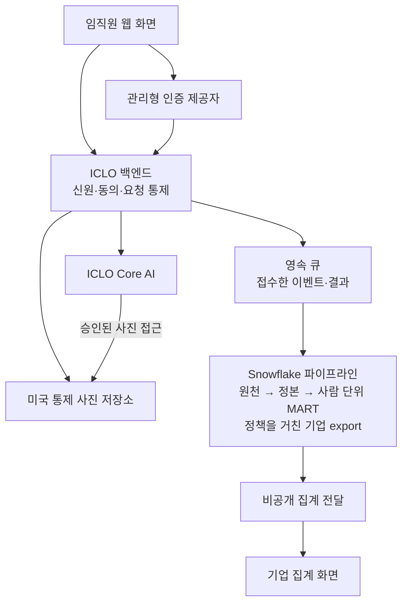
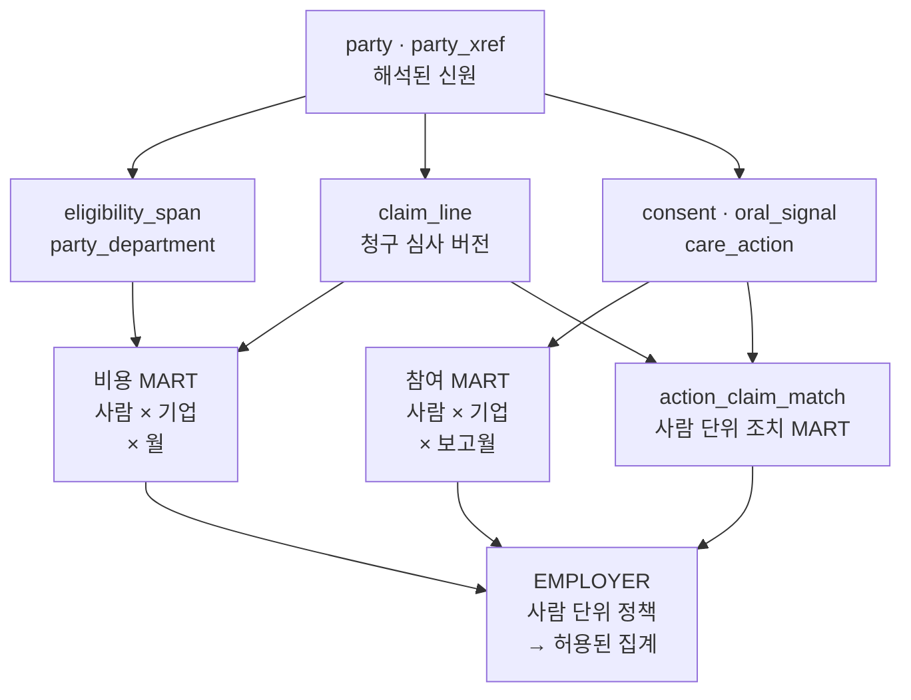

# ICLO × Snowflake — 소프트웨어·데이터 아키텍처

기술 부록 · v14 · 2026년 9월 7일  
[협업 제안서](proposal-KO.md) 부속 문서 · 한국어판

이 문서는 임직원의 참여, 사진에서 도출한 웰니스 신호, 청구로 확인한 조치를 연결하는 목표 설계다. ICLO와 Snowflake 아키텍트가 책임, 인터페이스, 인수 증거를 구체적으로 논의하도록 작성했다. 구현 승인서나 시스템이 운영 중이라는 설명은 아니다.

현재 저장소에서 실행되는 것은 로컬 합성 웹 데모다. 인증, 앱 백엔드, 통제 사진 저장소, Core AI 호출 경로, Snowflake에서 실행한 파이프라인은 없다. 첫 90일은 관계 구축, 설계 정렬, 선행 조건의 종결 경로를 다룬다. A3는 별도 승인할 합성 데이터 엔지니어링 단계이며, A2는 착수 게이트가 닫힌 뒤 실데이터와 임직원 서비스를 추가하는 단계다.

## 1. 세 단계의 실행 경계

| 단계 | 입력과 소프트웨어 경계 | 해당 증거로 확인할 수 있는 것 |
|---|---|---|
| 현재 데모 | 정본 YAML·HTML 템플릿 → 버전을 고정한 Python 빌더 → 로컬 HTML/CSS/JavaScript·허용 필드 JSON | 화면 동작, 합성 고지, 밴드, 동의 상태 예시, 로컬 억제 |
| A3 목표 | 합성 원천 파일 → Snowflake 변환·정책 → 검증된 기업별 export → 집계 화면 | 변환 재현성, 고유 인물 기준 억제, 기업 격리, 완전한 릴리스 처리 |
| A2 목표 | 사용 권한이 확보된 원천과 인증된 임직원 요청 → ICLO 백엔드·비공개 서비스 → 통제된 분석·비공개 전달 | 승인된 법적 근거, 신원, 동의, 보안, 서비스 경계 안에서의 운영 |

현행 빌더는 Python 3.14와 PyYAML을 사용하는 `scripts/build_screens.py`다. `screens/*.html.in`과 정본을 읽어 기업·임직원 화면을 만들며, 변조 검사를 위해 정본과 출력 경로를 바꿔 실행할 수 있다. 프론트엔드 프레임워크는 추가하지 않는다. 기업 화면의 `canon.json`은 정적 화면 필드와 데모 값을 담으며, 임직원 화면은 `member-canon.json`과 `member.json`을 쓴다. A3/A2에서는 기업 측정값과 신선도를 export로 옮기고, 정적 화면 계약은 계속 YAML에서 빌드한다. 합성 고지의 기준은 export의 `synthetic`이며, 문구는 “Synthetic data — illustrative only”다.

공개 GitHub Pages가 현재 발행하는 것은 리다이렉트 한 파일이다. 데모 서버나 승인된 export 목적지가 아니다. A3의 전달 경로는 별도 발행 결정이 필요하고, A2의 실데이터는 인증된 비공개 경로로 전달해야 하며 공개 Pages를 재사용할 수 없다. 현재 임직원 화면의 동의 검사는 브라우저에서 실행되는 상호작용 예시이지 서버 보안 통제가 아니다.

## 2. 소프트웨어 상세 설계

아래는 목표 구성도다. 브라우저 화면의 데모는 있지만 그 아래 운영 구성 요소는 아직 이 저장소에 없다. 화살표는 승인된 인터페이스를 뜻하며 자유로운 데이터 열람을 뜻하지 않는다.



| 구성 요소 | 책임과 접근 한계 |
|---|---|
| 임직원 웹 화면 | 인증된 본인의 밴드·방향을 보여주고 동의·촬영·지원 조치를 요청한다. Snowflake·추론 서비스 자격증명을 갖지 않는다 |
| 인증 제공자 | 관리형 패스워드리스 OTP. 정본에는 연락처 원문 대신 참조·해시를 둔다. 제품 선정은 미결이다 |
| 백엔드 | 작업마다 credential, 대상 인물, 기업 자격 맥락, 목적별 권한을 판정한다. 요청을 서버가 소유한 신원 레코드와 연결한다 |
| 사진 저장소 | 분석 계정과 분리된 ICLO 통제 미국 저장소. 원본 암호화와 접근 증거를 관리한다. 저장된 참조만으로 사진을 열 수 없다 |
| Core AI | 서비스 인증 뒤에서 ICLO가 직접 운영한다. 버전이 있는 품질 상태·밴드를 반환하고 요청과 추론 결과의 연결을 남긴다 |
| 큐·적재 | 수락한 이벤트·결과를 브라우저 수명과 무관하게 보존한다. 재처리와 중복 제거를 거쳐 정본으로 승격한다 |
| 기업 전달 | 권한이 있는 집계만 발행·조회한다. 기업에는 개인 프로필·사진·숫자 구강 점수·청구 라인을 노출하지 않는다 |

이 문서는 백엔드 기술이나 저장소 벤더를 선정하지 않는다. 표의 각 행마다 서비스를 하나씩 만들자는 뜻도 아니다. 필요한 것은 권한 판정과 영속 처리의 경계다. 기업 관리자가 동시에 임직원인 경우에는 역할·세션 맥락을 분리해야 한다. 맥락 전환으로 기업 권한이 개인 접근에 섞이거나 개인 앱 이용이 기업에 드러나면 안 된다.

### 요청 순서와 추론 계약

1. 임직원이 관리형 IdP로 인증한다. 백엔드는 1차 범위인 본인 프로필을 자격 정보와 매칭한다. OTP가 증명하는 것은 연락처 채널의 통제이지 임의로 주장한 신원의 진실성이 아니다.
2. 백엔드는 행위 credential, `party_sk`, 기업, 자격 에피소드를 확정한다. 작업 직전에 처리·사진 목적의 필수 동의, 현행 문안 버전, 만료, 철회, 접근권을 판정한다.
3. 승인된 촬영을 통제 저장소에 넣는다. 백엔드가 비공개 이미지 참조와 동의 기록을 요청에 묶으며, 다른 사람이나 기업의 참조를 가져온 요청은 거부한다.
4. 백엔드가 아래 기존 인터페이스로 ICLO Core AI를 호출한다. 사진 접근은 승인된 서비스 작업에 한정한다. DB에 있는 참조 자체는 접근 토큰이 아니다.
5. 백엔드는 응답을 검증하고 모델 버전·추론 ID를 남긴 뒤, 결과를 영속적으로 수락하여 적재한다. 임직원에게는 본인의 허용된 밴드·방향만 보여준다. 품질 게이트 실패는 사용할 수 있는 웰니스 신호가 아니다.
6. 분석 파이프라인은 동의·맥락, 멱등성, 지표의 중복 제거를 적용한다. 기업 전달 경로에는 통제된 집계만 도달한다.

```text
POST /v1/oral-signal
Authorization: <service credential>

요청 필드:
  image_ref       통제 이미지 참조. 이미지 바이너리가 아님
  consent_ref     승인된 동의 레코드 참조
  captured_at     촬영 시각
  request_id      하나의 논리 요청에 유지되는 식별자

성공 응답 필드:
  model_version   재현을 위한 필수 버전 식별자
  quality_passed  불리언
  signal_band     LOW | MODERATE | PRIORITY
  inference_id   추적 가능한 추론 식별자
```

기존 저장 컬럼은 `oral_signal.image_uri`, API 필드는 `image_ref`이며 백엔드가 둘을 연결한다. 네 필드로 구성된 요청에는 신뢰할 수 있는 대상 인물·기업 값이 직접 들어 있지 않다. 서비스는 인증된 서버 생성 참조의 맥락에서 이를 찾아야 한다. `consent_ref` 문자열이 있다는 사실만으로 활성 권한이 증명되지는 않는다.

`request_id`는 백엔드 요청 수락과 정본 중복 제거에 함께 쓰여야 한다. 수락한 요청이 다시 배달돼도 신호가 늘면 안 된다. 같은 ID로 사람·이미지·동의 맥락을 바꾸면 거부한다. 타임아웃 후 재시도에는 복구할 수 있는 결과·상태가 필요하며, 유일키 선언이나 브라우저 메모리만으로는 부족하다. 이는 앞으로 구현·검증할 요구이지 이미 중복 없는 처리가 운영 중이라는 주장이 아니다.

기록된 사진 접근 설계는 백엔드 발급, 유효기간 5분, 1회 사용이다. 만료 시간만으로 1회 사용이 보장되지는 않는다. 소비하는 백엔드·게이트웨이가 사용 여부를 원자적으로 기록하고 재사용을 거부하며, 추론 실패 후 복구 규칙을 정해야 한다. 저장소의 서명 URL만으로 이 요구가 강제된다고 설명하면 안 된다. 권한 만료나 동의 철회는 새 처리를 중단시켜야 하며, 사용과 철회가 동시에 일어나는 경우를 따로 검사해야 한다.

예약 넘김, 본인의 예약 자가 보고, 시스템이 확인한 예약은 서로 다른 이벤트다. 현재 데모가 예시로 제공하는 것은 앞의 둘이며, 어느 것도 방문이 있었다는 증거가 아니다. 향후 복리후생 조회 게이트웨이도 분석과 별개다. 과거 청구로 현재 잔여 보장 한도를 신뢰성 있게 계산할 수 없으므로, 권위 있는 누적·잔여 정보 원천을 계약·연동하기 전에는 그 값을 제공하지 않는다.

## 3. 데이터 상세 설계

### 원천 계약과 레이어 책임

| 원천 | 목표 입력 | 필요한 합의 |
|---|---|---|
| 기업 또는 benefits administrator | 통상 월 단위 X12 834 자격 파일 | 안정적인 가입자 식별자, 보장일, 정정 의미, 원천 인스턴스, 허용 목적 |
| HRIS 또는 benefits administrator | 유효기간이 있는 별도 부서 마스터 | 조직 범위, 임직원 연결 키, 부서 이동 이력 |
| TPA/ASO | X12 837D/835 또는 합의된 청구 추출 | 판정 버전, 조정 방식, 금액, 진료·수신일, 전달 완결성 |
| ICLO 앱 | 동의·문진·참여·조치 이벤트 | 행위자, 대상 인물, 기업 맥락, 이벤트 시각, 멱등성, 권한 근거 |
| ICLO Core AI | 품질 상태와 버전이 있는 사진 파생 신호 | 모델 버전, 이미지 참조, 요청 추적 정보, 촬영 시각 |

834는 자격 피드이며 부서 피드가 아니다. PER 세그먼트에 쓸 수 있는 연락처가 있는지는 샘플 파일로 확인할 사실이다. 1차 앱 범위는 임직원 본인이다. 가입 가족은 비용 분모에 포함될 수 있지만 가족 앱 접근은 다음 단계다.

초기 전달은 SFTP·합의된 배치 추출로도 가능하다. TPA가 호환되는 Snowflake 환경을 이미 쓴다면 Secure Data Sharing을 제공자와 함께 검토한다. 공유는 접근 수단이며, 데이터 권리·매칭 키·리전 간 전달 설계를 대신 확정하지 않는다. 초기 범위에 Native App이나 clean room은 필요하지 않다. [Snowflake 데이터 공유 문서](https://docs.snowflake.com/en/user-guide/data-sharing-intro)

| 레이어 | 책임 | 다음 단계로 넘기는 조건 |
|---|---|---|
| RAW | 원천 payload·적재 회차를 보존하여 통제된 재처리 지원 | 수신 manifest, 원천 신원, 허용 입력 확인 |
| STAGED | 원천 키를 유지하면서 타입 파싱·코드 표준화 | 잘못된 레코드 격리, 조용한 강제 변환 금지 |
| CANONICAL | 사람 연결과 자격·청구·동의·이벤트 이력 보존 | 신원 예외, 중복 버전, 잘못된 기간을 명시적으로 처리 |
| 사람 단위 MART | 버전 선택, 행 단위 정렬, 지표 모집단 계산 후 `party_sk` 유지 | 같은 스냅샷의 계보, 지표 fixture, 최소 셀의 인물 모집단 확인 |
| EMPLOYER | 정책이 걸린 사람 단위 객체 위의 제한된 뷰 | 실제 기업 역할 쿼리로 격리·최소 셀 검사 통과 |
| Export | 카탈로그·출처와 함께 일관된 집계 회차 발행 | 릴리스 전체의 스키마·시간·소유 기업·억제 검사 통과 |

### 엔터티, 행 단위, 관계



화살표는 논리 의존 관계이며 사람 단위 정책 경계를 우회하는 권한이 아니다. 조치 지표도 기업 집계 전에 고유 인물 모집단을 정의해야 한다.

| 객체 | 행 단위·키와 불변식 |
|---|---|
| `party` | 전역의 사람 한 명, 키는 `party_sk`. 기업 소속은 사람이 아니라 자격에 둔다 |
| `party_xref` | 원천 시스템 + 원천 인스턴스 + 원천 ID가 유일하다. 다른 기업은 같은 로컬 ID를 재사용할 수 있다 |
| `eligibility_span` | 자격 에피소드의 한 버전. 기업 + 안정적 에피소드 ID 안에서 해당 스냅샷까지의 최신 버전을 선택한다 |
| `member_month` | 자격 span × 월. 보장일을 보존하고 청구와 결합하기 전에 사람 × 기업 × 월로 접는다 |
| `claim_line` | 기업·원천 맥락, 진료일, 스냅샷을 갖는 판정 라인 버전. 취소·조정 계보를 보존한다 |
| `party_department` | 사람 × 기업 × 유효기간. 부서 미상은 `UNMATCHED`이며 억제용 `null`과 다르다 |
| `credential` / `profile_access` | 로그인 신원·접근권은 사람·기기와 별개다. 같은 연락처를 쓴다고 같은 사람이 되지 않는다 |
| `consent` | 목적·버전·행위자·대상·맥락과 생애주기 근거. 용도·수령자·만료를 포함한다 |
| `oral_signal` | 사람·기업·행위자·품질·요청·추론 ID를 갖는 버전별 촬영 |
| `care_action` / `action_claim_match` | 대상·관측 창이 있는 조치와 적합한 청구 라인의 명시적 연결. 신뢰도·종결 사유를 남긴다 |

결정적인 공통 식별자를 우선한다. 후보가 모호하거나 매칭되지 않은 사람은 예외 큐로 보내며, 1차에서는 매칭률을 높여 보이려고 확률적 매칭을 쓰지 않는다. 논리적 유일성은 적재 때 검사해야 하며 선언된 키만으로 성립한다고 가정하지 않는다.

### 시간과 금액 규칙

원천의 유효 시각, 이벤트 시각, 수신·적재 시각, 보고 스냅샷은 서로 다른 질문에 답하므로 각각 보존한다. 자격과 청구는 같은 `report_snapshot_seq`에서 선택한다. 과거 청구를 오늘 정정된 분모와 섞지 않는다. 현행 버전만 담은 `member_month`로는 과거 보고를 재현할 수 없다. 해당 스냅샷의 자격 버전을 다시 월별 전개해야 한다.

송신자의 보장 종료일 규약을 명시적으로 정규화한다. 현행 설계는 마지막 보장일을 포함하며, 각 달의 실제 일수를 쓴다. 자격과 청구를 각각 사람 × 기업 × 월로 접은 뒤 결합해야 한다. 그렇지 않으면 플랜 변경이 청구를 복제하거나 청구 여러 건이 보장일을 복제한다. 부서 유효기간 중첩은 사람의 지표를 조용히 늘리는 대신 승격을 중단한다.

보고월을 포함하는 롤링 지표의 창은 정확히 `[M-11, M+1)`이다. 보고월 M보다 11개월 전의 월 시작일은 포함하고, 다음 달 시작일은 제외한다. 2026년 9월 보고라면 2025년 10월 1일부터 2026년 9월 30일까지다. 최신 신호는 유효하지 않은 촬영을 먼저 뺀 뒤 사람·기업·보고월별로 선택한다.

청구를 쓰는 모든 경로는 `claims_as_of`가 해석한 지급·거절·취소·조정 버전을 공유한다. 허용액 원본 100 뒤에 대체값 80이 오면 결과는 180이 아니라 80이다. 증감분 −20은 다르게 해석해야 한다. 현재 SQL 설계는 대체 방식만 다루며, 증감 방식은 구현하거나 명시적으로 격리해야 한다. PMPM·완결성·조치 매칭이 조정 규칙을 각각 만들면 안 된다.

허용액, 플랜 지급액, 본인부담은 분리하고, 허용액 안쪽 본인부담·비보장액·타 지급자 금액 등도 대조할 수 있게 보존한다. 원천의 음수 조정액과 잘못된 음수 export 지표는 같은 문제가 아니다. TPA가 문서화한 금액 매핑으로 대조한 뒤 승격한다. Dental PMPM은 허용액을 가입자-월로 나눈 값이며 임직원 수가 분모가 아니다.

## 4. 지표 계약과 기업 통제

| 지표 | 정의와 보고 한계 |
|---|---|
| Eligible employees | 보고월 모집단의 고유 자격 임직원 수 |
| Activated | 그 자격자 중 월말까지 가입·첫 문진을 마친 사람. 현재 자격자 안에서 누적 분자를 구한다 |
| People with a valid capture | 참여한 자격자 중 보고월에 유효 촬영이 한 건 이상인 사람. 여기까지 세 단계만 포개지는 사람 퍼널이다 |
| Repeat participation | 같은 롤링 12개월에 유효 촬영이 2회 이상인 사람 / 1회 이상인 사람 |
| Signal distribution | 기업 맥락과 롤링 창 안에서 사람당 최신 유효 촬영 한 건. 모델 버전을 분리하거나 혼합 사실을 밝힌다 |
| Open care actions | 보고 시점에 미종료이며 조치의 유효기간 안에 있는 조치 수. 사람 퍼널의 다음 단계가 아니다 |
| Completed actions | 성숙 코호트 안에서 높은 신뢰도로 청구 확인된 조치 수. 별도 조치 수이며 완료율이 아니다 |

유효 촬영에는 품질 통과, 사람·날짜당 한 건, 사람·월당 최대 네 건이라는 공통 집계 규칙이 적용된다. 성숙 조치는 `opened_at + window_days + 청구지연 P90 < 보고 시각`을 충족한다. 완료율을 제공한다면 적합한 완료 조치를 이 성숙 조치 코호트로 나눈다. 최근 코호트는 따로 보여주며 P90이 아직 실측되지 않았으므로 완료 지표는 잠정이다. Open과 Completed는 포함 관계가 아니어서 미완료가 0건이어도 완료는 존재할 수 있다.

행 접근은 기업 범위를, 집계 정책은 공개할 모집단의 크기를 통제한다. 내부에서 버전 선택과 조인을 끝낸 사람 단위 MART에 `ENTITY KEY (party_sk)`와 집계 정책을 적용한다. 이미 기업별로 집계된 총계에 붙이지 않는다. Snowflake는 entity 기준 집계와 remainder 동작을 문서화하지만, 이 설계도 실제 계정에서 실행해 확인해야 한다. [Entity-level privacy](https://docs.snowflake.com/en/user-guide/aggregation-policies-entity-privacy), [행 접근 정책](https://docs.snowflake.com/en/user-guide/security-row-intro)

기업 역할에는 제한된 EMPLOYER 뷰를 주고 허용된 집계를 실행하게 한다. 내부 엔지니어·분석가의 면제는 정책 본문에 명시하고 검사해야 하며 역할 이름만으로 생기지 않는다. 기업 투영에서 식별자를 빼는 방법을 우선 검토한다. 마스킹을 쓴다면 고유 인물 수 계산이 보존되는지 입증한다. D3에서 정할 항목이다. Snowflake 공식 문서는 집계 정책을 Enterprise 이상 기능으로 설명한다. [집계 정책](https://docs.snowflake.com/en/user-guide/aggregation-policies)

작은 그룹은 Snowflake에서 그룹 키가 `NULL`인 remainder로 합쳐질 수 있고, DB는 그 remainder의 집계값을 반환할 수도 있다. ICLO의 export 계약은 더 엄격하다. `department=null`인 행에서는 모든 지표도 `null`이어야 한다. 화면은 억제를 명시하고 그 행에서 복원 가능한 인원·비율·막대 길이를 보여주지 않는다. 부서 이름은 별도 카탈로그에 남긴다. 부서 미상(`UNMATCHED`), 억제 remainder, 데이터 부재는 서로 다른 상태다.

최소 셀은 고유 인물 20명이다. 이 조건만으로 연관된 쿼리를 반복해 얻는 추론까지 막지는 못한다. 기존 설계에는 차원 고정, 위험한 비교의 양 끝에 적용하는 인접 억제, 이력에 따른 거부, 조합 수 제한도 있다. 모두 목표 통제이며 구현된 개인정보 보호를 보증하는 문장이 아니다. 롤링 모집단, 부서 이동, 가족 귀속, 합산 가능한 지표는 D5에서 정해야 한다. 작은 셀의 분모 노출도 별도 예외로 검토하며 카탈로그를 승인된 스키마 밖으로 확장하면 안 된다.

## 5. 원자적 export와 장애 처리

현행 A3 계약은 `employer-a.json`, `employer-b.json`, `employer-c.json`, `departments.json` 네 파일을 정한다. 한 릴리스에는 모두 있어야 한다. 기업 payload의 필수 내용은 다음과 같다.

| 구분 | 필수 필드 |
|---|---|
| Envelope | `schema_version`, `run_id`, `report_snapshot_seq`, `exported_at`, `employer_id`, `synthetic` |
| 신선도 | `eligibility_thru`, `claims_thru`, `lag_days`, `completeness_pct` |
| 행 식별 | `month_start`, `department`, `employer_id` |
| 모집단·비용 | `eligible_employees`, `covered_members`, `member_months`, `dental_pmpm` |
| 참여·신호 | `activated`, `repeat_participation`, `signal_low`, `signal_moderate`, `signal_priority` |
| 조치 | `open_actions`, `completed_actions`, `completed_cohort_mature` |
| 출처 | 지표별 원천 종류와 Snowflake 객체 |

각 월의 첫날을 날짜로 쓰며 연속된 서로 다른 36개월을 내보낸다. 36행 제한이 아니며 부서마다 행이 늘어난다. 기업 × 월 × 부서 키는 유일하고 세 기업 파일은 같은 월 집합을 갖는다. 스키마·회차·스냅샷은 전체 세트에서 일치한다. `exported_at`은 ISO 8601 UTC 오프셋을 포함하며 배달 시각을 뜻한다. 청구가 어느 시점까지 완결됐는지를 뜻하지 않는다.

카탈로그에도 공통 릴리스 envelope이 들어가되 기업 소유권은 `departments` 배열의 각 행에 비어 있지 않은 부서 이름과 함께 기록한다. 격리된 기업 역할 하나로 세 기업 전체의 카탈로그를 만들 수는 없다. D8에서 좁은 권한의 카탈로그 발행자를 정하거나 기업별 카탈로그 계약 개정을 승인해야 한다. 그 전에는 현행 네 파일 스키마가 검증 기준이며, A2에서 기업을 가로지르는 카탈로그를 허용한다는 뜻은 아니다. 예약된 내부 테스트 기업은 내보내기·보고 모집단에서 제외한다.

발행자는 완성된 불변 회차를 먼저 만들고 전체 검증 후 그 회차를 현행으로 전환해야 한다. 파일을 하나씩 덮어쓰면 원자적 전달이 성립하지 않는다. 기업 payload는 각각의 기업 역할로 만들며, 면제받은 엔지니어 역할로 뽑지 않는다. 적재 실패 시에는 승인된 경우에 한해 마지막 정상 회차를 명확히 표시하고 유지한다. 데모 상수로 대체해서는 안 된다. 모르는 스키마, 파일 누락, 회차 혼합, 잘못된 날짜, 중복 키, 잘못된 카탈로그 행, 다른 기업 레코드는 릴리스 거부 사유다.

원천 라벨과 객체 출처는 함께 필요하다. 완결성은 도착한 허용액을 예상 최종 허용액으로 나눈 값이며 청구 레코드 수의 수신 비율이 아니다. 방금 내보냈다는 이유로 오래된 자격이나 덜 도착한 청구가 최신처럼 보이면 안 된다. 런타임 소비자는 렌더링 전에 외부 값을 검사하고, HTML 텍스트·속성을 이스케이프하며, 색상·enum은 허용 목록으로 제한한다. 오래된 데이터·실패 상태는 화면에서 보이고 키보드로도 접근할 수 있어야 한다.

## 6. 운영, 생애주기, 인수 증거

동의는 가입 플래그를 복사해 쓰지 않고 사용 직전에 평가한다. 활성, 철회, 문안 버전 불일치, 만료, 동의 없음은 구별하며 잘못된 동의 레코드는 거부한다. 처리 동의를 철회하면 사진 동의가 켜져 있어도 사진 처리를 막는다. 자격 종료·재가입·문안 변경 때는 에피소드별로 다시 평가한다. 사망은 알림을 중단시키되 법적으로 유효했던 보장일을 조용히 바꾸지 않는다. 관리자의 즉시 접근 차단은 월간 자격 파일과 무관하게 작동해야 한다.

기록된 보존 설계는 원본 촬영 후 24개월, 파생 신호 자격 종료 후 7년, 동의 기록 영구다. 법률 확인이 필요한 ICLO의 설계 선택이며 법정 기간이나 구현된 삭제 약속이 아니다. 사람별로 암호화한 데이터 키, 버전 관리 저장소, 통제된 키 파기를 제안한다. 키 사본·백업·캐시·법적 보존·복구 불가능의 증거는 운영에서 검증해야 한다. 철회가 이미 배포한 보고서에 미치는 영향은 명시적인 미결 결정이며, 이 문서가 소급 재작성을 약속하지 않는다.

감사 증거는 신원·백엔드·사진 접근·추론·적재·export·관리자 이벤트를 요청·회차 ID로 연결해야 한다. 이미지 바이너리나 접근 토큰을 로그에 남기지 않는다. Snowflake Access History는 객체·컬럼 접근 증거를 보태지만 다른 시스템까지 기록하지는 않는다. [Access History](https://docs.snowflake.com/en/user-guide/access-history)

A3 배포는 버전 관리하는 DDL·정책, 재현 가능한 소규모 합성 데이터, 수동 실행 export부터 시작한다. 배치 적재·변환·내보내기에는 각각 책임지는 역할을 둔다. 웨어하우스 크기, 자동정지, 지연 목표, 예산 한도는 실행 측정으로 정한다. 이 제안서는 달러 비용 추정이나 절감 주장을 하지 않는다. A2에는 비공개 호스팅, 사고 책임, 복구 검사가 추가로 필요하다. Snowflake 공식 문서는 Business Critical 이상의 PHI 지원과 PHI 적재 전 BAA 체결 요건을 설명한다. 이 플랫폼 조건만으로 서비스 전체의 적합성이 성립하지는 않는다. [Snowflake 에디션](https://docs.snowflake.com/en/user-guide/intro-editions)

| 인수 영역 | 필요한 실패 사례와 통과 증거 |
|---|---|
| 기존 데모 | 정본 변조 → 실제 빌더 → DOM 확인. 임직원 JSON이 없으면 화면 중단 |
| 신원·시간 모델 | 원천 ID 재사용, 소급 종료, 나뉜 자격 기간, 부서 이력 중첩. 같은 스냅샷의 기대 합계 확인 |
| 청구 계보 | 대체·취소·미지원 증감 방식. 공통 해석으로 PMPM·조치 근거 대조 |
| 지표 | 롤링 경계일, 최신 촬영 품질 실패, 다른 기업 신호, 미완료 0·완료 존재, 미성숙 코호트 |
| Snowflake 정책 | 실제 기업 A/B 역할 쿼리. 고유 인물 19/20/21명, 한 사람의 반복 행, 마스킹·식별자 비투영 비교 |
| 기업 간 비간섭 | B/C 입력을 변경해도 회차·시각 메타데이터를 뺀 A의 정규화 payload는 동일 |
| Export·화면 | 파일 누락·혼합, 잘못된 카탈로그, 억제값 유출, 모르는 스키마. 완전한 회차는 억제·신선도 명시 |
| A2 서비스 | 다른 사람의 참조, 낡은 동의, 재사용, 추론 중단, 긴급 차단. 신호 중복 없이 영속 복구 |

로컬 SQL 검사와 fixture 산술은 유용하지만 Snowflake 역할·정책 실행을 증명하지는 못한다. 현재 export 검사는 demo에서 export 부재를 명시적으로 건너뛸 수 있으므로 통과가 파이프라인의 존재를 뜻하지 않는다. 새 게이트는 의도적으로 결함을 넣어 실패하는 것을 본 뒤에야 통과 결과를 증거로 인정한다.

닫아야 할 결정은 D3(정책 경계·면제), D5(시간 모집단·귀속), D8(카탈로그 발행자·스키마), D6(화면 실패 동작), 관리형 IdP, 실측 청구지연 P90, 동의 철회의 소급 효과다. 책임자와 증거를 지정해야 한다. 설계 완료가 다음 파트너 협의 조건의 충족이나 ICLO 내부의 별도 기술·운영 준비를 대신하지는 않는다.

| 착수 게이트 | 종결에 필요한 것 |
|---|---|
| HIPAA 역할 규정 | ICLO·기업·건강플랜·TPA·플랫폼 역할과 필요한 BAA의 서면 규정 |
| 데이터 권리 | 원천별·필드별·목적별 사용 권한 |
| 동의 이전 기준선 적재 | 동의 전에 기준선을 처리할 수 있는 서면 근거 |
| 공통 식별키 | 허용된 자격·청구·앱 신원의 연결 입증 |
| 주(州) 의료정보법 — 1차는 캘리포니아 CMIA | 적용 의무·authorization 요건 해결 |

<div style="break-before: page;"></div>

## 7. 설계 근거

이 문서는 #78 정정을 포함한 현행 로컬 저장소를 기준으로 작성했다. 기존 설계 결정을 유지하면서 구현 미완료와 원천 문서의 불일치를 표시한다. 집계 정책 경계를 다르게 적거나 계정이 확정됐다고 암시하는 과거 SQL 예시는 실행 증거가 아니다. 이 부록의 목표 설계에는 현재 브리프와 재구축 헌장을 적용했다.

- [정본 계약](../../contracts/proposal-package-v11.yml): 지표 시간 계약, export, 화면, 착수 게이트, 결정 기록.
- [제품 요구사항](../../employer-dashboard-poc/docs/PRD.md)과 [현재 아키텍처](../../employer-dashboard-poc/docs/ARCHITECTURE.md): 구현된 화면과 단계 경계.
- [내부 데이터 아키텍처 브리프](../../employer-dashboard-poc/docs/INTERNAL-DATA-ARCHITECTURE-BRIEF.md): D1–D8, 사람 단위 정책, 카탈로그 미결.
- [상세 기술 원문](../proposal-v10/06_Tech/ICLO-Evidence-Layer-DB-설계-KO.md): §§2–8, 10–12, 16–17. 과거 예시는 잠정 설계로 취급한다.
- [재구축 헌장](../../REBUILD-CHARTER.md): 빌드 결정과 현재 검증의 한계.

<style>
body { font-size: 11pt; line-height: 1.5; word-break: keep-all; overflow-wrap: anywhere; }
.cover h1.cover-title { font-size: 36pt; line-height: 1.2; color: #1B2A4A; }
h2, h3 { break-after: avoid; color: #1B2A4A; }
table { font-size: 9pt; }
td:first-child, th:first-child { min-width: 72pt; }
tr, figure { break-inside: avoid; }
thead { display: table-header-group; }
pre { white-space: pre-wrap; }
code { word-break: normal; overflow-wrap: anywhere; }
</style>
