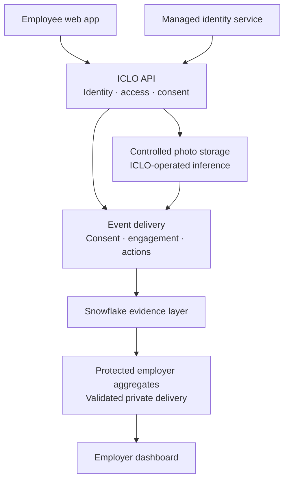
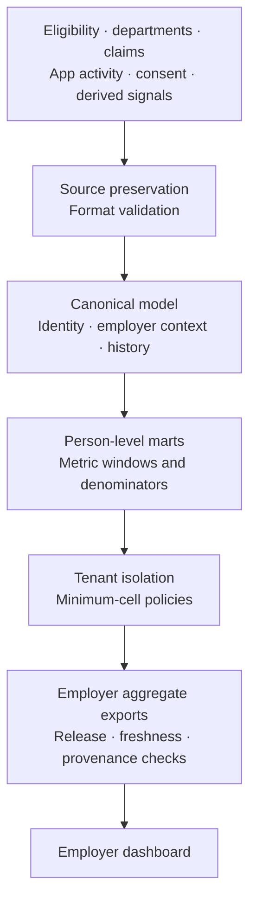

# Dental benefits: from engagement to claims-confirmed follow-through

## A Snowflake collaboration proposal for ICLO's US market validation

September 7, 2026 · v14 · For discussion · English edition

**The proposal.** ICLO is developing a service that connects employee participation, care recommendations and subsequent claims records within US employer dental-benefit programs. We propose working with Snowflake to assess the data architecture and controls needed for that connection, while establishing whether it addresses a real buyer need.

We request connections to US Healthcare & Life Sciences (HLS) business and solution architecture contacts, and introductions to three suitable employer candidates. The objective is to select one future proof-of-concept (PoC) partner that meets the data-rights and operating conditions. The first 90 days validate the relationship and design. Real-data loading and live service operations require separate approval.

Today, we have employee and employer screens running on synthetic data, a data-model and SQL design, and local validation tools. US buyer demand, the complete Snowflake execution path, and actual claims-confirmed program outcomes remain unvalidated.

## 1. Start with the decision the customer needs to make

A benefits team needs to understand more than whether employees opened an app. It needs evidence to decide **whether engagement is followed by actual care, where follow-through breaks down, and where to direct the next operating budget**.

The buyer problem ICLO will test is specific. Eligibility files identify the covered population. App records describe participation and recommendations. TPA claims record care utilization. Would linking those records to the same person and period create useful additional evidence? What decision would it improve compared with the employer's existing TPA reporting or broker renewal materials?

This is a buyer hypothesis. Existing reporting capabilities and frequency vary by employer; we do not assume they are limited to annual cost reports. Initial customer discussions will examine the actual reports, the unresolved workflow and the person responsible for its budget. **As of September 7, 2026, the repository contains no recorded US buyer problem-validation interviews.**

The initial target is an employer with a self-funded dental plan. Where the employer funds the plan and a TPA/ASO administers claims, utilization changes and plan-paid amounts can be examined together. The ASO scope and any stop-loss applicability and terms must be checked in the specific contract. Expansion to fully insured employers would require separate validation of what evidence the carrier recognizes.

The initial value proposition is better program operating decisions. More visits may also increase near-term claims costs. Cost reductions, return on investment and causal health improvements are therefore not promised outcomes of this proposal.

## 2. The proposed service and abstract software architecture

An employee participates with their own consent, completes a guided photo check-in and questionnaire, and receives their own band and direction statement. Where appropriate, the service offers general dental-consultation guidance and a next action. A click to find a dentist, an employee's statement that they booked, and a visit identified in claims remain separate events.

The employer sees aggregate participation and follow-through. The existing `Program overview`, `Oral-health signal distribution` and `Intervention funnel` screens provide the starting point. Live operations require delivery of validated data for that employer alone.

**Software diagram: responsibility boundaries in the target service.** The backend, authentication, photo storage and inference integration below are planned components. The running implementation today is a synthetic screen demonstration.

The employee API decides individual access and consent. Snowflake provides the analytical layer for connecting authorized records and producing employer aggregates. Browsers do not hold Snowflake credentials or query raw personal records directly. Authentication and delivery for the live employer dashboard also need to be built.

The first app scope covers employees acting for themselves. Family access follows a separate identity and authority design. Both surfaces use Low, Moderate and Priority bands and do not display numeric oral-health scores. A statement beside the result explains that the band is a wellness signal, not a clinical finding or medical advice. This display policy is not evidence of regulatory approval or legal sufficiency.

Benefit guidance is limited to information supported by an authoritative source. The service must not calculate a member's remaining benefit balance by summing delayed warehouse claims. If the relevant TPA cannot supply the necessary current information, the balance stays blank and the member is directed to the official inquiry channel.

## 3. Abstract data architecture: internal linkage, aggregate employer access

The service needs a data layer that interprets records from different sources against the same person, employer and time period. Individual records exist inside that processing layer. The protection requirement is to control who can read and use them.

**Data diagram: the target flow is tested with synthetic inputs in A3 and moves to authorized real inputs in A2 after its start conditions are met.**

| Input | Provider and purpose |
|---|---|
| Eligibility | Employer or benefits administrator; X12 834 or an agreed file establishes who is eligible and when |
| Department history | A separate employer HRIS file establishes department assignment at the reporting date |
| Claims and remittance | TPA/ASO; X12 837D and 835 or agreed extracts provide service dates, adjustments and plan-paid amounts |
| App and inference records | ICLO's app and directly operated Core AI provide events, consent and derived signals supporting participation and actions |

Raw oral images are kept outside Snowflake in the target design, in ICLO-controlled storage in a US region. References and derived signals are managed separately. Individual app results and employer aggregates have distinct access boundaries.

The minimum cell is **20 distinct people**, not 20 monthly rows or claim lines. Counts, percentages and bars for smaller cells are withheld together, with an explanation. The target data boundary applies policies while person keys remain available in a mart, then produces permitted aggregates. The design also addresses comparisons between neighboring cells that could reveal individual information. These are ICLO design requirements, not demonstrated database enforcement or a guarantee against all re-identification.

The detailed architecture annex covers software components and request contracts, data objects and grains, temporal processing, role permissions, export failure handling and acceptance tests.

## 4. Why validate this with Snowflake

Snowflake positions its healthcare and payer platform around connecting multiple data sources and enabling collaboration. ICLO proposes a specific application of that foundation: connecting dental-benefit participation with claims-confirmed follow-through. The fit must be established through customer demand and execution. [Snowflake Healthcare Payers](https://www.snowflake.com/en/solutions/industries/healthcare-and-life-sciences/healthcare-payers/)

The technical assessment centers on three questions.

1. **Source connectivity.** Where the TPA and account configuration support it, assess Secure Data Sharing. Same-region sharing provides access without copying the source data; ICLO's derived tables and exports still create separate data. Cross-region or cross-cloud delivery can require additional sharing or replication arrangements. Data-use rights must be established contractually in every case. [Secure Data Sharing](https://docs.snowflake.com/en/user-guide/data-sharing-intro), [Cross-region sharing](https://docs.snowflake.com/en/user-guide/secure-data-sharing-across-regions-platforms)
2. **Tenant isolation and aggregation controls.** Test row access and aggregation policies together in the actual account. An `ENTITY KEY` enables the minimum group size to count a person once even when their records span multiple rows. [Row access policies](https://docs.snowflake.com/en/user-guide/security-row-intro), [Entity-level privacy](https://docs.snowflake.com/en/user-guide/aggregation-policies-entity-privacy)
3. **Operating evidence.** Establish access records and data provenance that support monthly reprocessing and reproducible reporting. ICLO must connect application, storage, authentication and inference audit records beyond Snowflake's internal access history. [Access History](https://docs.snowflake.com/en/user-guide/access-history)

If validation succeeds, the proposed commercial value for Snowflake is a repeatable healthcare data use case and a basis for assessing subsequent customer opportunities. We do not present the small synthetic exercise as a large consumption opportunity. Its immediate value is establishing customer need and a workable control structure. Joint case studies and further go-to-market activity would be discussed separately, subject to partner consent and the evidence produced.

## 5. Measure engagement, follow-through and the ability to report

The first question is whether claims can reliably confirm follow-through within the program. Evidence of a visit does not establish that the program caused it.

| Observation | Interpretation rule |
|---|---|
| Participation | Count reporting-month eligible employees who completed registration and their first questionnaire |
| Valid capture | Count people meeting the quality conditions; repeated uploads do not become additional people |
| Repeat participation and band distribution | Use 12 months including the reporting month; distribution uses each person's latest valid capture |
| Open actions | Actions still open and within their action window on the reporting date |
| Claims-confirmed completion | Actions in a mature cohort confirmed by a HIGH-confidence claims match |
| Cost and freshness | Separate allowed amount per member-month, plan-paid amounts and member out-of-pocket; separate claims-through date from file delivery time |

The participation funnel is eligible employees, activated employees and people with a valid capture. Open backlog and mature-cohort completions are separate measures; dividing the two does not produce a completion rate. An absent claim is not automatically an absent visit. Completion measures remain provisional until claims lag has been measured.

Employer size is only an initial screening condition. In addition to the existing threshold of 250 employees, partner qualification must assess distinct contributors to the key outcomes, the observation period and what remains reportable after suppression. If those conditions are insufficient, the period or reporting scope must be reconsidered; the minimum-cell policy is retained.

## 6. Stages and conditions for proceeding

### First 90 days: validate the relationship and design

The following is a proposed discussion schedule starting from a mutually agreed kickoff. Real-data loading, a completed service and measured dental PoC outcomes are not delivery commitments for this period.

| Period | Work | Evidence to retain |
|---|---|---|
| Days 1-30 | Connect US HLS and architecture contacts; assess candidates and existing reporting workflows | Written follow-up, buyer problem and decision-maker, validation scope and owners |
| Days 31-60 | Assess software and data boundaries, source rights, identity linkage and control-test design | Agreed design scope, an owner and closure path for each open item |
| Days 61-90 | Assess candidates' data and operating fit; aim to select one future PoC partner; decide the next stage | A written proceed, revise or stop decision, with subsequent scope, budget and schedule |

### Subsequent A3: test execution with synthetic data

After establishing buyer evidence and technical readiness and receiving a separate start decision, run three synthetic employers and 36 months of inputs through actual Snowflake transformations and policies. Test cross-tenant access, aggregation below 20 distinct people, mixed export releases, retroactive corrections and reruns. Local SQL checks do not substitute for this execution.

### Subsequent A2: real data and live service operations

Before real-data loading, the following partner-facing conditions must be satisfied in writing and ICLO must complete its internal technical and operational readiness work. These are the current contract's conditions for external discussion; this proposal does not make or close the legal determinations.

| Condition | What must be established |
|---|---|
| HIPAA roles | The roles of ICLO, the employer health plan, the TPA, Snowflake and other parties, including required BAAs |
| Data rights | Permission to receive and use each source, field and purpose |
| Baseline load before consent | A lawful basis for records arriving before consent and records of nonparticipants |
| Common identity key | Stable linkage across eligibility, app and claims records, including exception handling |
| State health-information law (CA CMIA first) | Applicable requirements and consent/operating conditions, assessed separately from HIPAA |

The technical annex describes platform capabilities and contractual requirements. Selecting a capable platform and establishing suitability for the complete service are separate obligations.

Under the existing stop criteria, work does not proceed if no partner candidate is available, required data rights cannot be secured, or the required region configuration is unavailable. If buyers cannot identify incremental value over current reporting, or key results cannot be reported safely, the scope should be reassessed before expanding implementation.

## 7. Responsibilities and commercial terms

| Party | Proposed responsibility |
|---|---|
| ICLO | Product and metric contracts, app/inference integration and data-pipeline implementation, quality and access controls, operations and validation evidence |
| Snowflake | US HLS routing, architecture-contact connection, technical input on data controls and consideration of suitable candidate introductions |
| PoC partner and TPA/ASO | Buyer-problem validation, authorized source provision, and agreement on data rights, identifiers and claims interpretation |
| Each party's legal and security owners | Written determinations on actual processing scope and start conditions |

This allocation is proposed; Snowflake staffing or introductions are not yet committed. The scope assessment will account for ICLO service fees, TPA extraction and delivery charges, cloud consumption, legal/security costs and internal staff time. Amounts and cost ownership will be agreed once data access and operating scope are established. This document is not a quotation.

The running screens use **Synthetic data — illustrative only**. Backend services, real authentication, server-side consent enforcement, photo storage, the Core AI request path and actual Snowflake policy execution remain to be built or validated. Synthetic participation and cost figures are not business results or forecasts.

## 8. The next action requested

We propose a **60-minute working session with a US HLS contact and a solution architect**. ICLO will bring this proposal, the detailed architecture annex, the local synthetic demo and a source-data request outline.

The session should address the buyer problem and partner conditions, data controls, and the scope and ownership of subsequent validation. The requested outputs are:

- One written follow-up with US HLS and technical contacts, naming the responsible people.
- Confirmation of whether introductions to three self-funded dental-plan employer candidates are feasible, and the next steps. Broker- or consultant-led introductions can be included.
- Scope and owners for data-control tests using synthetic inputs.
- The next meeting date, owners of open items and the evidence required for the subsequent stage decision.

The first result of this collaboration would be an agreed customer problem and a data, access and measurement structure capable of answering it.

### Document note

The Korean and English editions carry the same scope, requests and start conditions. The accompanying **Software and Data Architecture** annex provides the detailed design. This document reflects the repository's contract, product requirements and execution architecture inspected on September 7, 2026. Official sources are linked for Snowflake capabilities; ICLO design proposals are distinguished from verified implementation.

