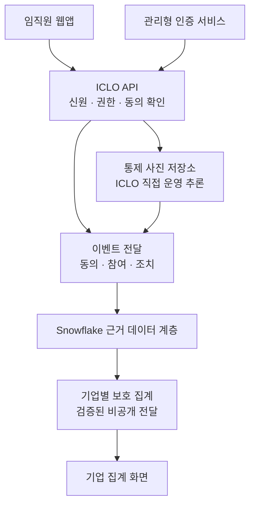
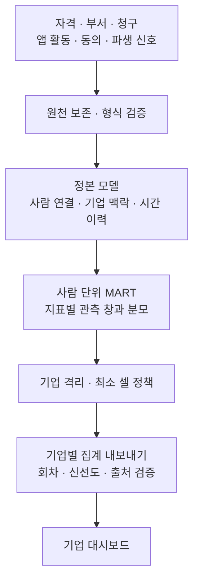

# 치과 복리후생, 참여에서 청구 확인까지

## ICLO의 미국 시장 검증을 위한 Snowflake 협업 제안

2026-09-07 · v14 · 협업 검토안 · 한국어본

**제안 요지.** ICLO는 미국 기업의 치과 복리후생 프로그램에서 임직원의 참여, 진료 권고, 실제 방문의 청구 기록을 연결하는 서비스를 추진하고 있습니다. Snowflake와 함께 그 연결을 뒷받침할 데이터 구조와 통제 방식을 검토하고, 실제 구매자의 필요를 확인하고자 합니다.

Snowflake에 요청하는 것은 미국 Healthcare & Life Sciences(HLS) 사업 담당자와 솔루션 아키텍트의 연결, 그리고 적합한 기업 후보 3곳의 소개입니다. 후보 중 데이터 권리와 운영 조건을 충족하는 1곳을 향후 PoC 파트너로 선정하는 것이 목표입니다. 첫 90일은 협력 관계와 설계를 검증하는 기간이며, 실데이터 적재와 실제 서비스 운영은 별도 승인 후 시작합니다.

현재 보유한 것은 합성 데이터로 실행되는 임직원·기업 화면, 데이터 모델과 SQL 설계, 로컬 검증 도구입니다. 미국 구매자 수요, Snowflake에서의 전체 실행, 청구로 확인된 실제 프로그램 성과는 아직 검증하지 않았습니다.

## 1. 고객이 내려야 하는 결정에서 시작합니다

복리후생 담당자가 프로그램을 도입한 뒤 알아야 할 것은 누가 앱을 열었는지에 그치지 않습니다. **참여가 실제 진료 이용으로 이어지는지, 어느 단계에서 연결이 끊기는지, 다음 운영 예산을 어디에 쓸지** 판단할 근거가 필요합니다.

ICLO가 검증할 고객 문제는 이렇습니다. 자격 파일에는 대상자가, 앱에는 참여와 권고가, TPA 청구에는 진료 이용 기록이 있습니다. 이 기록을 같은 사람과 기간으로 연결하면 프로그램 운영에 쓸 수 있는 추가 근거가 생기는가? 그 근거가 기존 TPA 보고서나 브로커의 갱신 자료에 비해 어떤 결정을 더 잘 내리게 하는가?

이것은 현재의 구매자 가설입니다. 기업마다 기존 보고서의 기능과 주기가 다르므로 이를 일률적으로 연간 비용 보고라고 전제하지 않습니다. 첫 고객 대화에서는 실제 보고서를 확인하고, 해결되지 않은 업무와 그 업무에 예산을 배정할 사람을 찾겠습니다. **2026-09-07 기준 저장소에 기록된 미국 구매자 문제 검증 대화는 없습니다.**

첫 검증 대상은 자기부담(self-funded) 치과 플랜을 운영하는 기업입니다. 기업이 플랜 비용을 부담하고 TPA/ASO가 청구 처리를 맡는 구조에서, 이용 변화와 플랜 지급액을 함께 살펴볼 수 있기 때문입니다. ASO 업무 범위와 stop-loss 적용 여부·조건은 해당 계약에서 확인합니다. 완전보험(fully-insured) 기업으로의 확장은 캐리어가 어떤 근거를 인정하는지 별도로 확인한 뒤 검토합니다.

초기 구매 가치는 프로그램의 운영 판단을 개선하는 데 있습니다. 방문 증가가 단기 청구 비용 증가로 이어질 수도 있습니다. 따라서 비용 절감률, 투자수익률, 건강 개선의 인과효과를 이 제안의 약속으로 두지 않습니다.

## 2. 제안하는 서비스와 소프트웨어 아키텍처 개요

임직원은 본인의 동의 아래 구강 사진 체크인과 문진을 진행하고, 본인에게만 제공되는 밴드와 방향 설명을 확인합니다. 필요한 경우 일반적인 치과 상담 안내와 다음 행동으로 연결됩니다. 앱에서 치과 찾기를 눌렀다는 기록, 본인이 예약했다고 말한 기록, 청구에서 방문이 확인된 기록은 각각 구분합니다.

기업 담당자는 집계 화면에서 참여와 후속 행동을 확인합니다. 현재 화면의 `Program overview`, `Oral-health signal distribution`, `Intervention funnel`을 출발점으로 삼되, 실제 운영에서는 검증된 기업별 데이터만 전달하도록 설계합니다.

**소프트웨어 구조도: 목표 서비스의 책임 경계.** 아래 백엔드·인증·사진 저장·추론 연결은 구축 대상입니다. 현재 실행되는 범위는 합성 화면입니다.

임직원 API는 개인의 권한과 동의를 판단하고, Snowflake는 허용된 데이터를 연결하고 기업별 집계를 만드는 분석 계층을 담당합니다. 브라우저가 Snowflake 자격증명을 보유하거나 원본 개인 레코드를 직접 조회하는 구조로 만들지 않습니다. 운영 시 기업 화면의 인증·전달 경로도 별도로 구축해야 합니다.

1차 앱 범위는 임직원 본인입니다. 가족 대리 접근은 신원·권한 설계가 선행되는 후속 범위입니다. 양쪽 화면은 Low·Moderate·Priority 밴드를 사용하며 숫자 구강 점수를 표시하지 않습니다. 밴드는 웰니스 신호이며 임상 소견이나 의학적 조언이 아니라는 설명을 결과 옆에 둡니다. 이 표시 정책 자체가 규제 승인이나 법적 적합성의 증거는 아닙니다.

보장 안내는 확인 가능한 원천에 한정합니다. 청구 창고의 지연된 금액을 합산해 개인의 잔여 보장 한도를 계산하지 않습니다. 해당 TPA에서 필요한 실시간 정보를 제공할 수 없으면 잔여 한도는 비워두고 공식 조회 경로로 안내합니다.

## 3. 데이터 아키텍처 개요: 연결은 내부에서, 기업에는 집계로

이 서비스에는 서로 다른 원천의 기록을 같은 사람·기업·기간으로 해석하는 데이터 계층이 필요합니다. 개인 레코드가 내부 처리 계층에 존재하므로, 보호의 핵심은 각 주체가 읽고 사용할 수 있는 범위를 통제하는 데 있습니다.

**데이터 구조도: A3에서는 합성 입력으로 검증하고, A2에서는 착수 조건을 충족한 실제 입력으로 전환하는 목표 흐름입니다.**

| 입력 | 제공 주체와 용도 |
|---|---|
| 가입 자격 | 기업 또는 benefits administrator의 X12 834 또는 합의 파일. 누가 언제 플랜 자격을 갖는지 확인 |
| 부서 이력 | 기업 HRIS의 별도 파일. 보고 시점의 부서 귀속 확인 |
| 청구·지급 | TPA/ASO의 X12 837D·835 또는 합의 추출. 서비스일·청구 정정·플랜 지급액 확인 |
| 앱·추론 기록 | ICLO 앱과 직접 운영하는 Core AI의 이벤트·동의·파생 신호. 참여와 조치의 근거 |

원본 구강 이미지는 Snowflake에 적재하지 않는 설계입니다. ICLO가 통제하는 미국 리전 저장소에 두고 참조와 파생 신호를 관리합니다. 앱의 개인 결과와 기업용 집계 사이에는 별도의 접근 경계를 둡니다.

최소 셀은 **고유 인물 20명**을 기준으로 합니다. 월별 행이나 청구 항목 수로 사람 수를 대신하지 않습니다. 임계값 미만 셀은 인원·비율·막대를 함께 감추고 이유를 표시합니다. 목표 데이터 경계에서는 사람 키가 남아 있는 MART에 정책을 적용한 뒤 허용된 집계를 만들며, 위험한 이웃 셀의 차이로 개인 정보가 드러나는 경우도 통제 대상으로 둡니다. 이는 ICLO의 설계 요구이며, 현재 DB에서 실증된 보호나 완전한 재식별 방지의 약속은 아닙니다.

상세 기술 부록은 소프트웨어 구성요소와 호출 계약, 데이터 객체와 행 단위, 시간 처리, 역할별 권한, 내보내기 실패 처리, 검증 기준을 다룹니다.

## 4. Snowflake와 함께 검증할 이유

Snowflake는 의료·보험 분야에서 여러 원천의 데이터 연결과 조직 간 협업을 지원하는 플랫폼을 제시합니다. ICLO는 그 기반 위에 치과 복리후생의 참여 기록과 청구 확인을 연결하는 구체적인 활용 사례를 제안합니다. 적합성은 고객 수요와 실제 구현으로 확인해야 합니다. [Snowflake Healthcare Payers](https://www.snowflake.com/en/solutions/industries/healthcare-and-life-sciences/healthcare-payers/)

기술 검토의 중심은 세 가지입니다.

1. **원천 연결.** TPA와 계정 구성이 맞으면 Secure Data Sharing을 검토합니다. 같은 리전의 공유는 원천 데이터를 복사하지 않고 접근하는 경로를 제공하지만, ICLO가 만드는 파생 테이블·내보내기에는 별도 데이터가 남습니다. 다른 리전·클라우드는 별도의 전달·복제 구성이 필요할 수 있고, 어느 방식이든 데이터 사용 권리는 계약으로 확인해야 합니다. [Secure Data Sharing](https://docs.snowflake.com/en/user-guide/data-sharing-intro), [리전 간 공유](https://docs.snowflake.com/en/user-guide/secure-data-sharing-across-regions-platforms)
2. **기업 격리와 집계 통제.** 행 접근 정책과 집계 정책의 조합을 실제 계정에서 검증합니다. `ENTITY KEY`를 사용하면 여러 행에 걸친 동일 인물을 최소 그룹 크기의 한 사람으로 평가할 수 있습니다. [행 접근 정책](https://docs.snowflake.com/en/user-guide/security-row-intro), [Entity-level privacy](https://docs.snowflake.com/en/user-guide/aggregation-policies-entity-privacy)
3. **운영 근거.** 접근 이력과 데이터 출처를 확인하고, 월별 재처리와 보고서 재현에 필요한 증거를 남깁니다. Snowflake 내부 접근 이력 외에 앱·사진 저장소·인증·추론의 감사 기록은 ICLO가 별도로 연결해야 합니다. [Access History](https://docs.snowflake.com/en/user-guide/access-history)

Snowflake에 기대하는 사업적 가치는, 검증에 성공할 경우 반복 가능한 의료 데이터 활용 사례와 후속 고객 기회를 함께 검토할 수 있다는 점입니다. 초기 합성 검증의 사용량을 큰 매출로 제시하지 않습니다. 첫 단계의 가치는 고객 필요와 통제 가능한 실행 구조를 확인하는 데 있습니다. 공동 사례 발표와 추가 영업 협력은 파트너 동의 및 검증 결과를 바탕으로 별도 협의합니다.

## 5. 검증할 것은 참여·연결·측정 가능성입니다

첫 질문은 “청구 데이터로 프로그램의 후속 행동을 신뢰할 수 있게 확인할 수 있는가”입니다. 방문의 근거가 있다는 사실과 프로그램 때문에 방문했다는 주장은 다릅니다.

| 관측 항목 | 해석 규칙 |
|---|---|
| 참여 | 보고월 자격자 안에서 가입·첫 문진을 완료한 사람을 셈 |
| 유효 촬영 | 품질 조건을 충족한 사람을 셈. 반복 업로드를 사람 수 증가로 읽지 않음 |
| 반복 참여·밴드 분포 | 보고월을 포함한 12개월을 관측. 분포는 사람별 최신 유효 촬영을 기준으로 함 |
| 미완료 조치 | 보고일 현재 유효기간 안의 미종료 조치 잔량 |
| 청구 확인 완료 | 충분히 관측된 성숙 코호트에서 연결 신뢰도 HIGH로 확인된 조치 |
| 비용과 신선도 | 가입자-월당 허용액, 플랜 지급액, 본인부담을 구분. 청구 기준일과 파일 배달 시각도 구분 |

참여 퍼널은 자격자→참여자→유효 촬영자입니다. 미완료 잔량과 성숙 코호트 완료 수는 별도 지표이며, 두 수를 나눠 완료율을 만들지 않습니다. 청구가 아직 도착하지 않은 상태를 미방문으로 단정하지 않고, 청구 지연의 실측값이 정해지기 전에는 완료 지표를 잠정으로 표시합니다.

기업 규모는 초기 선별 조건일 뿐입니다. 임직원 250명 이상이라는 기존 기준에 더해, 핵심 결과에 기여하는 고유 인물 수·관측 기간·억제 후 보고 가능성을 확인해야 합니다. 조건을 충족하지 못하면 기간이나 보고 범위를 다시 합의하고, 최소 셀 기준을 낮추지 않습니다.

## 6. 추진 단계와 통과 조건

### 첫 90일: 협력 관계와 설계의 성립 여부

아래는 착수일 합의 후 적용할 논의 일정입니다. 실데이터 적재, 완제품 구축, 실제 치과 PoC 성과 측정은 이 기간의 납품 약속에 포함되지 않습니다.

| 구간 | 할 일 | 남길 결과 |
|---|---|---|
| 1~30일 | 미국 HLS 담당자·아키텍트 연결, 고객 후보 검토, 기존 보고 업무 확인 | 서면 후속, 구매자 문제와 의사결정자, 검증 범위와 담당자 |
| 31~60일 | 소프트웨어·데이터 경계, 원천·권리·식별키, 통제 시험 설계 검토 | 합의한 설계 범위, 미결 항목별 책임자와 종결 경로 |
| 61~90일 | 후보의 데이터·운영 적합성 확인, 향후 PoC 파트너 1곳 선정 목표, 후속 단계 판단 | 진행·보완·중단의 서면 판단과 후속 범위·예산·일정 |

### 후속 A3: 합성 데이터로 실행 구조 검증

고객 근거와 기술 준비 상태를 확인하고 별도 착수 판단을 받은 뒤, 3개 합성 기업·36개월 입력을 실제 Snowflake 변환과 정책 경계에 통과시킵니다. 다른 기업 데이터 접근, 고유 인물 20명 미만 집계, 회차가 섞인 내보내기, 소급 정정과 재처리를 시험합니다. 로컬 SQL 검사가 통과했다는 사실로 이 단계를 대체하지 않습니다.

### 후속 A2: 실제 데이터와 서비스 운영

실데이터 적재 전에는 다음 파트너 협의 조건을 서면으로 충족하고, ICLO 내부의 기술·운영 준비도 완료해야 합니다. 아래는 현행 계약에서 대외 협의 대상으로 정한 항목이며, 본 제안서가 법적 판단이나 종결을 대신하지 않습니다.

| 조건 | 확인할 내용 |
|---|---|
| HIPAA 역할 규정 | ICLO·기업 건강플랜·TPA·Snowflake 등 각 당사자의 역할과 필요한 BAA |
| 데이터 권리 | 원천·필드·목적별 수령 및 사용 권한 |
| 동의 이전 기준선 적재 | 동의 전에 들어오는 기록과 비참여자 기록의 적법한 처리 근거 |
| 공통 식별키 | 자격·앱·청구의 동일인을 연결할 수 있는 안정적 키와 예외 처리 |
| 주(州) 의료정보법 — 1차는 캘리포니아 CMIA | HIPAA 검토와 별도로 적용 범위 및 필요한 동의·운영 조건 확인 |

플랫폼 기능과 계약 요건은 상세 기술 부록에서 설명합니다. 기능을 갖춘 플랫폼을 선택하는 것과 서비스 전체의 적합성을 확인하는 것은 각각 필요한 일입니다.

파트너 후보가 없거나, 필요한 데이터 권리를 얻을 수 없거나, 요구한 리전 구성이 불가능하면 기존 중단 기준에 따라 진행하지 않습니다. 구매자가 기존 보고서 대비 추가 가치를 확인하지 못하거나 핵심 결과를 안전하게 보고할 수 없다면, 구현 확대에 앞서 범위를 다시 판단합니다.

## 7. 역할과 사업 조건

| 주체 | 제안하는 역할 |
|---|---|
| ICLO | 제품·지표 계약, 앱·추론 연결과 데이터 파이프라인 구현, 품질·접근 통제, 운영 및 검증 자료 작성 |
| Snowflake | 미국 HLS 연결, 아키텍처 검토 담당자 연결, 데이터 통제 방식에 관한 기술 협의, 적합 후보 소개 가능성 검토 |
| PoC 파트너와 TPA/ASO | 구매자 문제 확인, 승인된 원천 제공, 데이터 권리·식별키·청구 해석 협의 |
| 당사자별 법무·보안 책임자 | 실제 처리 범위와 착수 조건 검토 및 서면 결정 |

역할 배분은 제안이며 Snowflake의 인력 투입이나 소개가 확약된 상태는 아닙니다. ICLO 서비스 비용, TPA의 추출·전달 비용, 클라우드 사용료, 법무·보안 검토에 필요한 비용과 내부 시간을 함께 산정하겠습니다. 금액과 부담 주체는 원천 접근성과 운영 범위가 정해진 뒤 합의하며, 본 문서는 견적서가 아닙니다.

현재 실행되는 화면은 **Synthetic data — illustrative only**입니다. 백엔드·실제 인증·서버측 동의 강제·사진 저장소·Core AI 호출 경로·Snowflake의 실제 정책 실행은 구축 또는 검증 전입니다. 합성 데모의 참여율과 비용은 사업성과나 예상 실적으로 사용하지 않습니다.

## 8. 이번 논의에서 요청하는 다음 행동

**미국 HLS 담당자와 솔루션 아키텍트가 참여하는 60분 작업 회의**를 제안합니다. ICLO는 본 제안서, 상세 기술 부록, 로컬 합성 데모와 원천 데이터 요청 항목을 준비하겠습니다.

회의에서는 고객 문제와 파트너 조건, 데이터 통제 방식, 후속 검증의 범위와 책임자를 순서대로 정하고자 합니다. 회의 후 필요한 결과는 다음과 같습니다.

- 미국 HLS·기술 담당자와의 서면 후속 1건 및 각 담당자.
- 자기부담 치과 플랜 기업 후보 3곳의 소개 가능 여부와 다음 절차. 브로커·컨설턴트 경유 소개도 포함합니다.
- 합성 검증에서 확인할 데이터 통제 시험의 범위와 책임자.
- 다음 회의 날짜, 미결 항목 책임자, 후속 단계 진행 판단에 필요한 근거.

이 협력의 첫 성과는 고객 한 곳의 실제 문제와, 그 문제에 답할 수 있는 데이터·권한·측정 구조를 함께 확인하는 것입니다.

### 문서 안내

한국어와 영어는 동일한 범위·요청·착수 조건을 담습니다. 상세 내용은 동봉한 **Software and Data Architecture / 소프트웨어·데이터 아키텍처** 부록을 참조하십시오. 본 문서는 2026-09-07에 확인한 저장소의 계약·제품 요구·실행 구조를 기준으로 작성했습니다. Snowflake 기능 설명에는 공식 문서를 연결했으며, ICLO의 설계 제안과 검증된 구현은 구분합니다.

