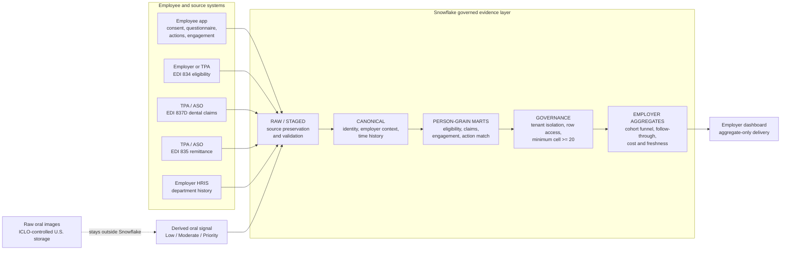

# Homeden: Governed Oral Health Evidence Layer for U.S. Employers

## Data architecture in a nutshell

This is the Snowflake-facing diagram: what enters the governed evidence layer, what stays outside it, and what the employer is allowed to see.

## How to narrate it in 30 seconds

ICLO keeps raw oral imagery outside Snowflake in controlled U.S. storage. What enters Snowflake is the structured evidence layer: eligibility, claims, remittance, HR context, app events, consent records and derived oral-signal bands. Inside Snowflake, those records are standardized, linked at person grain, and governed before any employer view is produced. The employer never sees individual PHI or image data; it sees only aggregate measures such as participation, claims-confirmed follow-through, plan-paid cost and reporting freshness, with suppression applied below 20 distinct people.

## What Snowflake audiences should take away

- Snowflake is the governed evidence layer, not the image repository.
- The value is joining engagement to eligibility and claims, not storing another wellness app backend.
- The privacy boundary is explicit: person-grain processing inside the governed layer, aggregate-only output to employers.
- This design supports payer / TPA collaboration patterns such as Secure Data Sharing where available, without making that a prerequisite for the first pilot.
